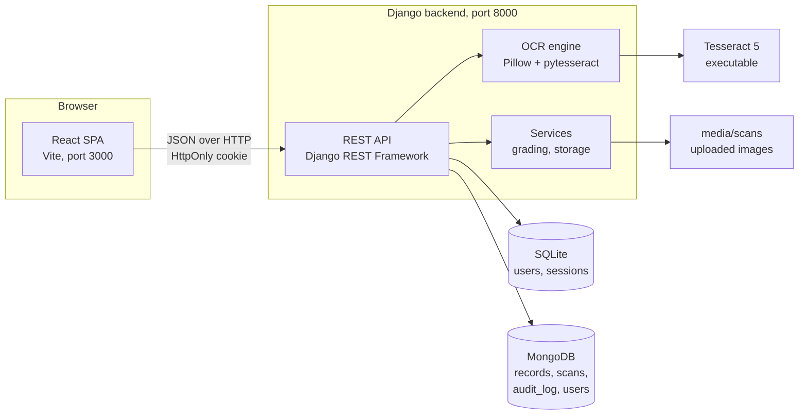
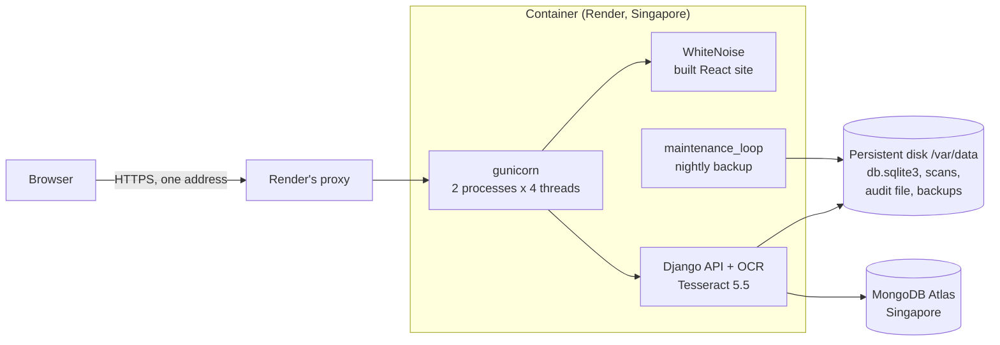
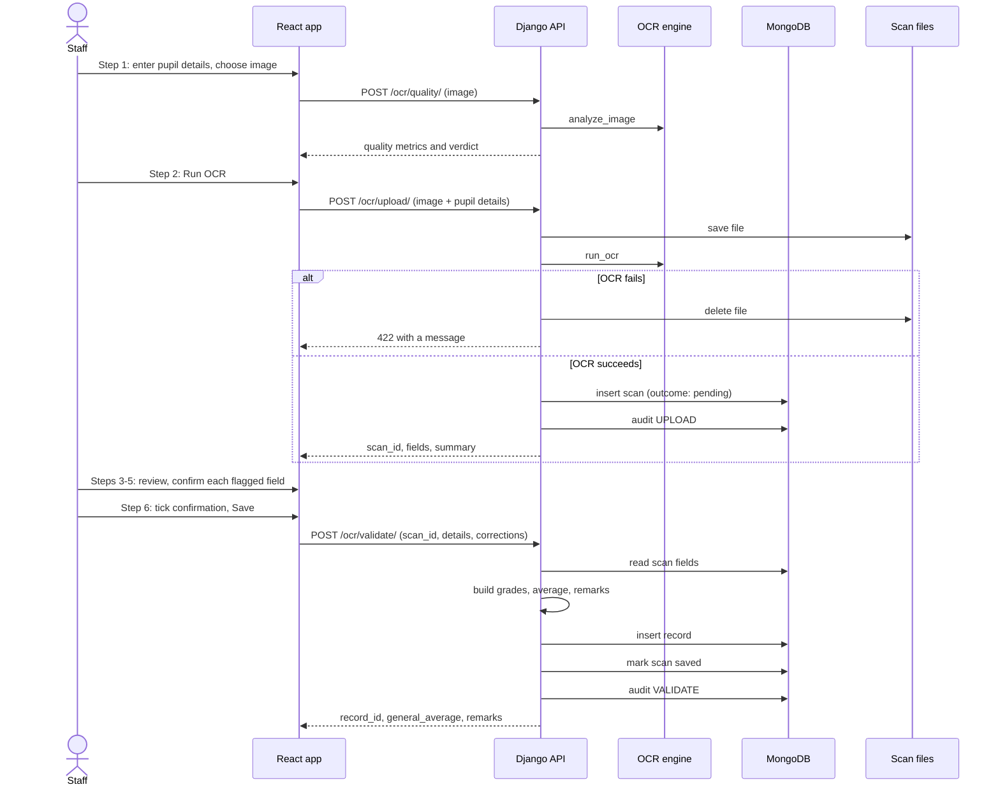
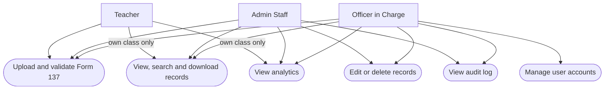

# System Architecture

## 1. Overview

OCRIS is a three-tier web application:

1. A **React single-page application** in the browser.
2. A **Django REST API** that holds the business logic and the OCR engine.
3. **Two data stores**: SQLite for user accounts and sessions, MongoDB for records, scans and the audit log. Uploaded images are kept on the server's disk.



### Why two databases

- **SQLite** holds what Django's authentication system manages: user accounts, hashed passwords and login sessions. Using Django's built-in user model gives password hashing, password rules and the admin site without extra code.
- **MongoDB** holds the school data. A Form 137 record is a natural document: the set of subjects differs between forms and year levels, and each record carries a nested grade sheet. Storing it as one document avoids a fixed schema of subject columns.

SQLite is the source of truth for users. A copy of each user (without the password) is mirrored to a MongoDB `users` collection for reference.

### In the cloud

On a cloud host the same parts run in one Docker container (`Dockerfile`, `render.yaml`; set-up in [DEPLOYMENT.md](DEPLOYMENT.md)):



- **One address for the site and the API.** Django serves the built site (`FRONTEND_DIST`) through WhiteNoise, so the frontend calls `/api` on its own address, the sign-in cookie is `SameSite=Lax` and no CORS is needed.
- **One persistent disk** (`DATA_DIR`) holds everything the server writes; the rest of the container is replaced on every deploy. A disk allows only one instance.
- **OCR stays inside the upload request.** Render allows long requests, and the threads of the web server keep other requests answered while a form is read (about 300 MB and 30 to 70 seconds each).
- **The nightly upkeep** runs next to the web server (`maintenance_loop`), because the host's scheduled jobs cannot reach the disk.

## 2. Backend

Location: `backend/`. Framework: Django 5.2 with Django REST Framework.

```
backend/
  manage.py
  seed.py                   creates the default accounts
  requirements.txt
  ocris_backend/
    settings.py             configuration (reads .env)
    urls.py                 /admin/ and /api/
  api/
    models.py               OCRISUser: roles, class assignment, class access check
    authentication.py       sign-in cookie authentication, session expiry, request-header check, temporary-password lock
    password_validators.py  letters-and-numbers password rule
    permissions.py          IsOIC, IsOICOrAdmin
    tests.py                automated tests
    management/commands/    backup, restore, maintenance, create_indexes, cleanup_scans, decrypt_backup, encrypt_scans, recompute_remarks, tidy_records, verify_audit
    serializers.py          login, user, and validation payloads
    urls.py                 all /api/ routes
    constants.py            passing grade, N/A handling, remark names
    db.py                   every MongoDB read and write
    views/
      auth.py               login, logout (one device or all), current user, change password, forgot password
      records.py            list, search, filter options, detail, create (typed-in forms), update, delete
      ocr.py                quality check, upload, validate, download, history
      analytics.py          grade analytics
      sections.py           the section tree: list, add, edit, delete
      users.py              user management
      audit.py              audit log
    services/
      grading.py            builds the grade sheet, average, and remarks
      storage.py            saves, finds and streams uploaded files (encrypted when a key is set)
      crypto.py             encryption at rest for scans and backups
      maintenance.py        removes abandoned uploads by itself (at most once an hour, when someone uploads)
      uploads.py            file type, size and content checks on uploads
      accounts.py           sign-in limits and password rules
      audit.py              old and new values for audit entries
    ocr/
      engine.py             read_scan / run_ocr entry points, error handling, retry on a smoothed copy
      pdf.py                opens a scan as an image; renders the pages of a PDF
      quality.py            image quality measurements
      preprocess.py         straightening and clean-up before OCR
      table.py              reads the grade table cell by cell; one or two table columns (SF10-ES)
      parser.py             subject names; free-text fallback parser
      pupil.py              reads name, LRN, grade, section, school year
    utils/http.py           small request and response helpers; the teacher's-own-class check
```

### Layering

| Layer | Modules | Responsibility |
|---|---|---|
| Routing | `api/urls.py` | Maps URLs to view functions |
| Views | `api/views/*` | Check permissions, read the request, call the layers below, write the audit log, shape the response |
| Services | `api/services/*` | Business rules that do not depend on HTTP: grading and file storage |
| OCR | `api/ocr/*` | Everything about turning an image into fields |
| Data access | `api/db.py`, `api/models.py` | MongoDB queries and the Django user model |

Views are function-based (`@api_view`). Each declares its allowed methods and its permission class directly above the function, so the access rule for an endpoint can be read in one place.

## 3. Frontend

Location: `frontend/`. React 18 built with Vite. No router library and no state library are used.

```
frontend/src/
  main.jsx                  entry point
  App.jsx                   maps page names to page components
  context/AppContext.jsx    login state, current page, nav()
  data/constants.js         sidebar items, option lists, role labels
  utils/
    api.js                  HTTP client for the backend
    useFetch.js             load-data hook (data, loading, error, refetch)
    useObjectUrl.js         image previews
    useRecordOptions.js     filter choices taken from saved records
    useClassPicker.js       grade and section choices from the section tree; locked for teachers
    format.js               dates, N/A checks, error messages
    compare.js              tolerant text comparison
  components/
    layout/Sidebar.jsx      navigation
    layout/Topbar.jsx       page title, menu button on narrow screens, change password, sign out
    layout/ChangePasswordModal.jsx
    ui/index.jsx            Card, Btn, Badge, Pager, EmptyState, ...
    ui/DownloadScanBtn.jsx  download button for the original scan
    ui/ScanPreview.jsx      shows an uploaded scan (image or PDF)
    ui/Chart.jsx            Chart.js charts for Grade Analytics
  assets/                   DepEd seal and logo for the SF10-ES sheet
  pages/
    LoginPage, DashboardPage, UploadPage, RecordsPage, RecordDetailPage,
    SearchPage, AnalyticsPage, HistoryPage, UsersPage, AuditPage,
    SectionsPage, FillFormPage
    upload/                 one component per upload step
    users/                  add form, edit dialog, permission matrix
    sections/               add/edit and delete-confirmation windows
    form137/                the SF10-ES sheet (sheet.jsx) and the print button
  styles/                   global.css, components.css, pages.css
```

### Navigation and state

- `AppContext` holds `loggedIn`, `user`, `activePage` and `navParams`.
- Pages change screen by calling `nav('records')` or `nav('detail', { recordId })`. `App.jsx` looks the page name up in its `PAGES` table.
- The sidebar and the top-bar titles are both generated from `NAV_ITEMS` in `data/constants.js`. An item can list the roles allowed to see it; `App.jsx` applies the same rule to the page itself.
- When the page opens, `AppContext` asks the server who the sign-in cookie belongs to (`GET /auth/me/`) and restores the session, so the user stays signed in after a refresh. A user who still has a temporary password sees an unclosable "Choose your own password" window (`App.jsx`) until it is changed.
- While the app is open, `AppContext` asks `GET /auth/me/` again when the window is focused and every 3 minutes, and replaces `user` only if it changed. A teacher whose class the OIC changed sees the new class without signing in again; a user whose session ended is returned to the login screen (only a `401` does that, so a server hiccup does not sign anyone out). The server never relied on the cached user: every request reads the account from the database.
- The upload wizard (`UploadPage.jsx`) keeps the data gathered so far in one object and passes it to each step. Once a form is read, its scan and fields are also stored on the server, so `PendingUploads.jsx` can list the unsaved ones (`GET /ocr/pending/`) and restart the wizard at step 4 with `GET /ocr/scans/<id>/`. While the wizard is between step 2 and the success screen, the browser asks before the page is left or refreshed.

### Talking to the backend

All requests go through `utils/api.js`, which calls `VITE_API_URL` (`http://localhost:8000/api` in development, `/api` in the cloud build) and:

- sends every request with the sign-in cookie (`credentials: 'include'`) and the `X-OCRIS-Request` header; the cookie is HttpOnly, so the frontend never holds or stores a token;
- on a `401` response, returns to the login screen (except for the check made when the page opens);
- throws `{ status, data }` for HTTP errors and `{ status: 0, offline: true }` when the server cannot be reached, so pages can show a suitable message;
- downloads files by fetching them as a blob, because a plain link cannot send the request header.

## 4. Main data flow: digitizing a form



Two points in this flow are deliberate design decisions:

- **The scan and the record are separate documents.** The scan keeps what the machine read; the record keeps what a person approved. The record's `corrections` field and the scan's `ocr_fields` together show exactly what was changed by hand.
- **The pupil details on the record come from what the staff member typed, not from OCR.** The details read from the scan are only used to warn when they disagree with what was typed.

The OCR stage itself is described in [OCR_PIPELINE.md](OCR_PIPELINE.md).

## 5. Users and roles



Roles are stored on the user model (`OCRISUser.role`). Permissions are enforced by the backend on every request; the exact rule for each endpoint is in [SECURITY.md](SECURITY.md) and [API.md](API.md).

## 6. Configuration

All environment-specific settings are read from `backend/.env` and `frontend/.env` (on Render, from the service's environment); see [INSTALLATION.md](INSTALLATION.md) and [DEPLOYMENT.md](DEPLOYMENT.md). Settings fixed in `settings.py` that affect behaviour:

| Setting | Value | Effect |
|---|---|---|
| `TIME_ZONE` | `Asia/Manila` | Django's time zone |
| `TOKEN_TTL_HOURS` | 12 (from `.env`) | Hours a sign-in stays valid |
| `MAX_UPLOAD_MB` | 20 (from `.env`) | Largest accepted scan; refused with `413` |
| `AUTH_PASSWORD_VALIDATORS` | 10 characters, letters and numbers, not common, not numeric, not like the name | Password rules |
| `OCR_LANG` | `eng` | Tesseract language |
| `OCR_CONFIDENCE_THRESHOLD` | 90 | Auto-approval threshold used by the free-text fallback parser |
| `PAGE_SIZE` (`api/db.py`) | 20 | Rows per page in lists |
| `PASSING_GRADE` (`api/constants.py`) | 75 | Used for remarks, pass rates and intervention flags |
