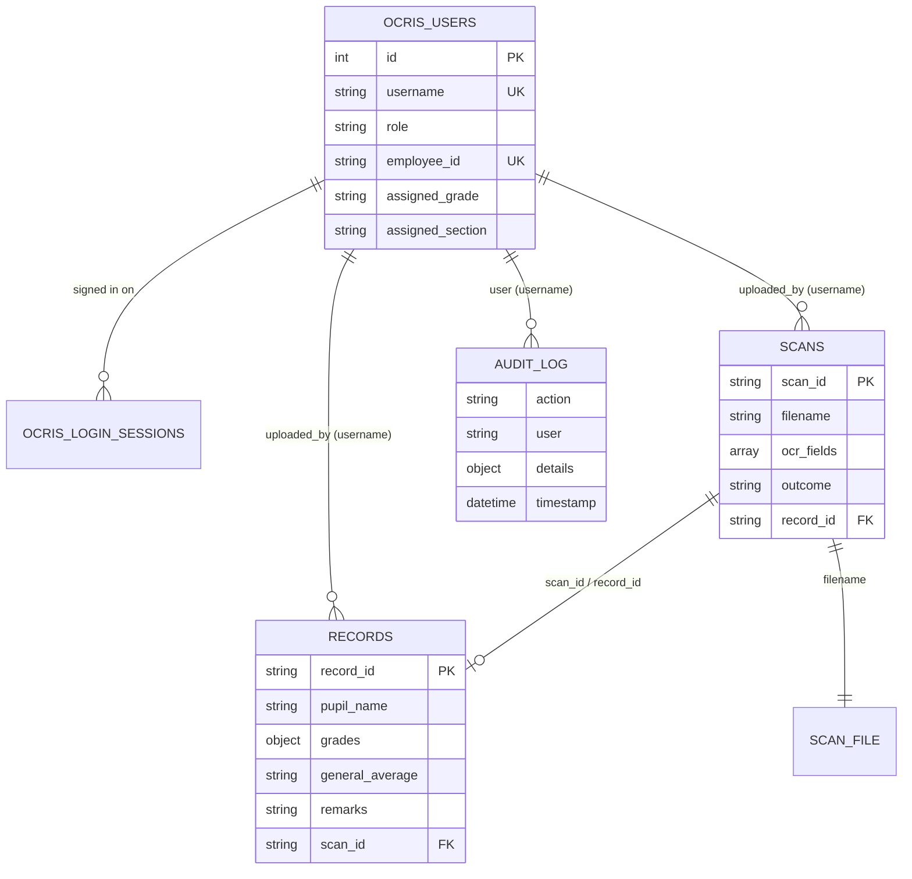

# Database Design and Data Dictionary

OCRIS uses two databases and a file folder.

| Store | Holds | Defined in |
|---|---|---|
| SQLite (`backend/db.sqlite3`) | User accounts, login sessions, sign-in attempts | `backend/api/models.py`, Django migrations |
| MongoDB (database named by `MONGO_DB_NAME`) | `records`, `scans`, `audit_log`, `users`, `grade_levels` (the section tree; see [API.md](API.md#sections)) | `backend/api/db.py` |
| File system (`backend/media/scans/`) | Uploaded scan images | `backend/api/services/storage.py` |

## Relationships

MongoDB does not enforce relationships. The links below are kept by the application.



Users are referenced by **username stored as text**, not by ID. This is why deleting a user account leaves that user's records, scans and audit entries intact.

---

## MongoDB collections

All dates are stored in UTC and sent by the API with a `Z` suffix (for example `2026-10-01T05:12:44.118000Z`), so browsers show them in local time. MongoDB's own `_id` field exists on every document but is never returned by the API.

### `records`

One document per validated Form 137. Created by `POST /api/ocr/validate/`.

| Field | Type | Description | Example |
|---|---|---|---|
| `record_id` | string | Unique ID: `REC-<year>-<8 hex characters>` | `REC-2026-7C1E4A90` |
| `pupil_name` | string | As typed at upload: `Last name, First name` | `Santos, Maria Joy L.` |
| `lrn` | string | Learner Reference Number; may be empty | `104512090034` |
| `grade_level` | string | As chosen at upload | `Grade 6` |
| `section` | string | As typed at upload | `Sampaguita` |
| `school_year` | string | As chosen at upload | `2024-2025` |
| `class_adviser` | string | The adviser typed on an SF10-ES sheet; empty for scanned records | `Gloria D. Ramos` |
| `grades` | object | Grade sheet, see below | |
| `general_average` | string or null | Mean of numeric Final grades, one decimal place | `"86.4"` |
| `remarks` | string | `Promoted`, `Retained` or `Incomplete` | `Promoted` |
| `grading_period` | string | `quarter` (four quarters: every scan, and older forms typed in) or `term` (three terms, stored as `Q1` to `Q3` with `Q4` `N/A`). A record saved before 2026-10-18 has none and counts as `quarter` | `term` |
| `status` | string | Always `validated` | `validated` |
| `uploaded_by` | string | Username of the person who saved the record | `g.ramos` |
| `scan_id` | string | The scan this record was made from; empty for a record typed in on the Fill Out Form 137 page | `SCAN-3F9A1C2B` |
| `corrections` | object | Values entered by hand during validation, keyed by field name | `{"English I Q2": "88"}` |
| `details` | object | The rest of a typed-in SF10-ES sheet, see below; empty for scanned records. An archive-only record (uploaded without scanning) has `{"archive_only": true}`, empty `grades`, and a `null` `general_average` | |
| `created_at` | datetime | When the record was saved | |
| `updated_at` | datetime | Last change | |

**`grades`** maps each subject to its quarterly (or term) and final grades. Values are strings; a blank grade is `"N/A"`.

```json
{
  "English I":     { "Q1": "87", "Q2": "88", "Q3": "85", "Q4": "90", "final": "88" },
  "Mathematics I": { "Q1": "80", "Q2": "N/A", "Q3": "82", "Q4": "84", "final": "82" }
}
```

On a multi-year Form 137-A the subject key includes the year level (`English I`, `English II`). On a scanned SF10-ES it includes the block's grade (`Filipino Grade 4`), or `Block 1` to `Block 4` when the grade could not be read.

**`details`** holds what a typed-in SF10-ES sheet has beside the record's own grades, so the sheet can be shown again for editing and printing. Text is cut to 100 characters and lists to 40 entries.

| Key | Type | Description |
|---|---|---|
| `name_ext`, `middle_name`, `birthdate`, `sex` | string | The learner's other personal information |
| `eligibility` | object | The eligibility section: `kinder_progress_report`, `eccd_checklist` (true or false), `school_name`, `school_id`, `school_address`, `pept_rating`, `exam_date`, `others`, `testing_center`, `remark` |
| `blocks` | array of 8 | Each scholastic-record block as typed, four on the front and four on the back: `school`, `school_id`, `district`, `division`, `region`, `grade_level`, `section`, `school_year`, `adviser`, `rows` (learning area `subject` with the ratings `Q1` to `Q3`, or `Q1` to `Q4` for a record kept in quarters, and `final`), and `remedial` (`from`, `to`, `rows`). A record saved before the back page was added has 4 blocks. Rows saved then may also hold a `Q4`. |
| `certifications` | array of 3 | The certification boxes on the back: `learner_name`, `lrn`, `grade`, `school_name`, `school_id`, `division`, `last_school_year`, `date`, `signatory` |
| `total_pages` | string | The "of ___" in "Page 2 of ___" |

The three term ratings of a typed form are stored as `Q1` to `Q3`; `Q4` is saved as `N/A`. A form typed in quarters (`grading_period` `quarter`) keeps `Q4`.

The record's own `grade_level`, `section`, `school_year` and `grades` are those of the last block that has grades.

### `scans`

One document per successful OCR run. Created by `POST /api/ocr/upload/`.

| Field | Type | Description | Example |
|---|---|---|---|
| `scan_id` | string | Unique ID: `SCAN-<8 hex characters>` | `SCAN-3F9A1C2B` |
| `filename` | string | Name of the stored file in `media/scans/`: `<8 random characters>_<sanitized original name>` | `1197b7a9_form137.png` |
| `original_name` | string | The filename as uploaded; used when downloading | `form137.png` |
| `file_size_bytes` | integer | Size of the upload | `2483112` |
| `uploaded_by` | string | Username | `g.ramos` |
| `pupil_name` | string | As typed at upload | |
| `grade_level` | string | As chosen at upload | |
| `section` | string | As typed at upload | |
| `school_year` | string | As chosen at upload | |
| `lrn` | string | As typed at upload | |
| `ocr_fields` | array | Everything OCR read, see below | |
| `ocr_text` | string | All the text read off the page, up to 20,000 characters; used by search. Scans uploaded before 2026-10-10 do not have it. | |
| `notes` | array of strings | Remarks the reader made about the scan (a page skipped, a block named from the others). Kept so an upload that is resumed shows them again. Scans uploaded before 2026-10-11 have none. | |
| `overall_conf` | number | Mean confidence of fields with a confidence above 0 | `88.4` |
| `flags_count` | integer | Fields flagged for review | `14` |
| `null_count` | integer | Blank fields | `3` |
| `archive_only` | boolean | Stored with **Archive only**, without being read: no confidence or flags | `false` |
| `corrections_count` | integer | Corrections submitted at validation; 0 until saved | `14` |
| `outcome` | string | `pending` after upload, `saved` after validation, `record deleted` once its record was deleted (the scan and file are kept) | `saved` |
| `record_deleted_by`, `record_deleted_at` | string, datetime | Who deleted the record and when; only when `outcome` is `record deleted` | |
| `record_id` | string or null | The record made from this scan | `REC-2026-7C1E4A90` |
| `created_at` | datetime | When the scan was uploaded | |

**`ocr_fields`** items:

| Key | Type | Description |
|---|---|---|
| `field` | string | Field name, e.g. `Pupil Name`, `English I Q1` |
| `raw` | string | What OCR read |
| `value` | string | Interpreted value, or `N/A` |
| `conf` | integer | Confidence, 0–100 |
| `status` | string | `ok`, `warn` or `null` |
| `flagged` | boolean | `true` when `status` is `warn` |

### `audit_log`

One document per logged action. Never updated or deleted by the application. Each entry is also appended, as one JSON line, to `backend/logs/audit.jsonl` (`AUDIT_LOG_FILE`) **before** it is stored here, so the trail survives if the database is wiped, replaced or unreachable. Keep that file on storage that a deploy does not wipe, and include it in backups.

| Field | Type | Description |
|---|---|---|
| `action` | string | See the table below |
| `user` | string | Username of the person who did it |
| `details` | object | Depends on the action |
| `timestamp` | datetime | When it happened |
| `hash` | string | The entry's hash in the audit file's chain, so the file can be checked against the database (`manage.py verify_audit`); missing for entries from before 2026-10-18, and in the tests. Not returned by `/audit/` |

| Action | Written when | `details` |
|---|---|---|
| `LOGIN` | A user logs in | `role`, `ip` |
| `LOGIN_FAILED` | A wrong username or password. `user` is the name that was typed | `ip` |
| `LOGIN_LOCKED` | Repeated failures locked that username | `ip`, `minutes` |
| `LOGOUT` | A user signs out | `all_devices` (only when every device was signed out) |
| `PASSWORD_RESET_REQUEST` | A user asked for a new password from the login screen | `ip` |
| `UPLOAD` | A scan is uploaded and read, or archived without reading | `scan_id`, `filename`, `confidence`, `pupil`; for an archive-only upload `record_id` and `archive_only` instead of `confidence` |
| `VALIDATE` | A record is saved | `scan_id`, `record_id`, `corrections` (count), `corrected` (`[{field, read, new}]`: what the OCR read and what a person entered), `pupil`, `grade` |
| `EDIT` | A record is updated | `record_id`, `pupil`, `fields`, `changes` (`{field: {old, new}}`), `grade_changes` (`[{subject, period, old, new}]`) |
| `DELETE` | A record is deleted; its scan is kept | `record_id`, `pupil`, `scan_kept`, `record` (a snapshot: identity fields, average, remarks and every grade) |
| `DOWNLOAD` | An original scan is downloaded | `scan_id`, `filename`, `pupil` |
| `CANCEL_UPLOAD` | An unfinished upload is cancelled and its file deleted | `scan_id`, `filename`, `pupil` |
| `CREATE_USER` | A user account is created | `new_user`, `role` |
| `DELETE_USER` | A user account is deleted | `deleted_user`, `role` |
| `EDIT_USER` | A user account is changed | `target_user`, `fields`, `changes` (`{field: {old, new}}`; passwords are never logged) |
| `RESET_PASSWORD` | The OIC sets a user's password | `target_user` |
| `CHANGE_PASSWORD` | A user changes their own password | none |
| `ENCODE` | A record is typed in on the Fill Out Form 137 page | `record_id`, `pupil`, `grade` |
| `ADD_SECTION` | A section is added | `section`, `grade` |
| `EDIT_SECTION` | A section is renamed or moved to another grade level | `section`, `grade`, `was` |
| `DELETE_SECTION` | A section is deleted | `section`, `grade` |

### `grade_levels`

The section tree: one document per grade level, holding its sections. Records and user accounts store their section as plain text, so renaming or deleting a section here does not change them.

| Field | Type | Description |
|---|---|---|
| `grade_level` | string | `Grade 1` to `Grade 6`; one document each, created when its first section is added |
| `sections` | array | The sections of that grade level |
| `sections[].section_id` | string | Unique ID: `SEC-<8 hex characters>` |
| `sections[].name` | string | Section name; unique within the grade level, ignoring case |
| `sections[].created_at`, `sections[].updated_at` | datetime | |

### `users`

A mirror of the SQLite user table, without passwords. It is refreshed when the user list is viewed and when a user is created, edited or deleted. SQLite is the source of truth; nothing reads this collection.

| Field | Type | Description |
|---|---|---|
| `username` | string | Unique key for the mirror |
| `full_name` | string | |
| `email` | string | |
| `role` | string | `OIC`, `ADMIN` or `TEACHER` |
| `employee_id` | string | |
| `assigned_grade` | string or null | |
| `assigned_section` | string or null | |
| `is_active` | boolean | |
| `synced_at` | datetime | Last time this entry was written |

---

## SQLite tables

### `ocris_users`

Model: `OCRISUser`, which extends Django's `AbstractUser`.

| Column | Type | Description |
|---|---|---|
| `id` | integer, primary key | |
| `username` | varchar(150), unique | Login name |
| `password` | varchar(128) | Hashed by Django (PBKDF2); never stored in plain text |
| `first_name`, `last_name` | varchar(150) | |
| `email` | varchar(254) | Optional |
| `is_active` | boolean | `false` blocks login (a deactivated account) |
| `is_staff`, `is_superuser` | boolean | Used only by the Django admin site |
| `last_login`, `date_joined` | datetime | |
| `role` | varchar(10) | `OIC`, `ADMIN` or `TEACHER`; default `TEACHER` |
| `employee_id` | varchar(20), unique, nullable | |
| `assigned_grade` | varchar(20), nullable | Teacher's class, e.g. `Grade 6` |
| `assigned_section` | varchar(50), nullable | Teacher's class, e.g. `Sampaguita` |
| `must_change_password` | boolean | `true` while the password is a temporary one set by the OIC |
| `password_reset_requested_at` | datetime, nullable | When the user asked for a reset from the login screen; cleared when the OIC sets a password |

### `ocris_login_sessions`

Model: `LoginSession`. One row per sign-in on one device (replaces the old one-token-per-user table `authtoken_token`, which is no longer used).

| Column | Type | Description |
|---|---|---|
| `key` | varchar(64), primary key | SHA-256 (hex) of the random value kept in the `ocris_session` HttpOnly cookie; the value itself is not stored |
| `user_id` | integer | The owner; a user can have several rows |
| `created` | datetime | The session stops working `TOKEN_TTL_HOURS` (12) hours after this |
| `last_active` | datetime | Last use (written at most once a minute); the session stops working `IDLE_TIMEOUT_MINUTES` (30) after this |
| `user_agent` | varchar(200) | The browser that signed in |

A row is deleted on sign-out (that device only), by "sign out everywhere", when the user changes their password (their other devices), when the OIC sets a new password, when it expires (when its cookie comes back, or at anyone's next sign-in), and when the account is deleted.

### `ocris_auth_attempts`

Model: `AuthAttempt`. Failed sign-ins (`kind = login`) and password-reset requests (`kind = reset`), counted to limit how often they can be made.

| Column | Type | Description |
|---|---|---|
| `kind` | varchar(10) | `login` or `reset` |
| `username` | varchar(150) | Lower-case name that was typed (it need not exist) |
| `ip` | varchar(45) | Address of the caller |
| `at` | datetime | |

Failures of a username are deleted by its next successful sign-in; everything older than a day is deleted when a new attempt is recorded.

The remaining SQLite tables (`django_session`, `auth_group`, `auth_permission`, `django_admin_log`, and so on) are standard Django tables and are not used by OCRIS's own features.

---

## Indexes

Created by the server the first time it connects to a database (`db.ensure_indexes()`), and by `python manage.py create_indexes` or `maintenance`; safe to repeat. An index that cannot be built, for example a unique one over data that already has duplicates, is logged and skipped. The list is `INDEXES` in `backend/api/db.py`.

| Collection | Indexed on |
|---|---|
| `records` | `record_id` (unique), `lrn`, `school_year` + `pupil_name`, `grade_level` + `created_at`, `created_at`, `scan_id` |
| `scans` | `scan_id` (unique), `outcome` + `created_at`, `uploaded_by` + `outcome`, `grade_level` + `created_at`, `created_at` |
| `audit_log` | `timestamp` |
| `users` | `username` (unique) |
| `grade_levels` | `grade_level` (unique), `sections.section_id` |

These serve the lists and their paging, the duplicate check (same school year and name, or same LRN), the LRN lookup, scan history, the cleanup of old pending scans and the Audit Log page. They do **not** speed up the search box: it looks for text anywhere inside names, subjects and scanned text, which no ordinary index can do, and a section is matched ignoring case. At the size of one school (thousands of records) that is fast enough; a much larger archive would need MongoDB text search. The accounts database (SQLite) has its own indexes for the sign-in limit table.

## Uploaded files

| | |
|---|---|
| Folder | `backend/media/scans/` |
| Stored name | `<8 random hex characters>_<original name with unsafe characters replaced by _>` |
| Linked from | `scans.filename` |

The random prefix stops two uploads with the same filename from overwriting each other. Files are only served through `GET /api/ocr/scans/<scan_id>/file/`, which checks that the resolved path is inside this folder.
